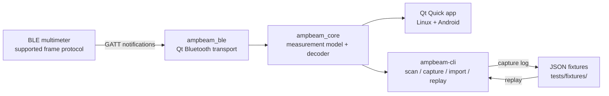

# AmpBeam

<p align="center">
  
</p>

AmpBeam is a Linux and Android application plus reusable C++23 library for
Bluetooth Low Energy multimeters like the **HANMATEK CO601** that speak the frame protocol documented in
[docs/protocol.md](docs/protocol.md). It is a clean-room implementation: only
bytes observed on the wire are decoded, and every field is marked as verified or
unknown.

[](https://github.com/ChristianMayer/AmpBeam/actions/workflows/ci.yml)
[](LICENSE)

> **Status: early, but useful on the tested meter.** Discovery, the device-info
> read and the 15 byte measurement stream are verified against one physical
> meter (series 61, firmware 1.4.0). On that unit the decoder reports DCV, ACV,
> DCA, ACA, resistance, continuity, diode, capacitance, frequency with duty
> cycle or AC voltage (Hz/V), NCV field levels, HOLD and auto-range flags, the
> MinMax view with its MAX reading (MIN and AVG are not transmitted), relative
> measurement (REL), the oscilloscope mode and the front-panel keys 1–3.
> Everything else is reported as raw bytes or as `Kind::Unknown`. `core/` is
> gated at 100% line coverage.

## Suspected compatibility (not a hardware finding)

The protocol resembles the one used by the meters sold as **OWON B35T/B41** and
**Voltcraft VC871/VC891**, and by other devices that advertise the `fff0` GATT
service with the `fff1`–`fff4` characteristics. These are the devices we suspect
will work directly or with only a UUID or decoder-name adaptation, but **none of
them has been verified in this project**. Use `ampbeam-cli --scan` and a short
capture to check whether a device matches [docs/protocol.md](docs/protocol.md);
series 61 is the only series whose 15 byte format has been confirmed.

## What is in here

| Component | Description |
| --- | --- |
| `core` (`ampbeam_core`) | Dependency-free C++23 measurement model, hex helpers, GATT profiles, capture/fixture handling and the `FrameDecoder` implementations. |
| `ble` (`ampbeam_ble`) | Qt 6 Bluetooth transport: device discovery, connection, service discovery, notification subscription and command writes. One implementation for Linux (BlueZ over D-Bus) and Android. |
| `app` | Qt Quick application (`ampbeam`) for Linux desktop and Android. |
| `cli` (`ampbeam-cli`) | Headless mirror, CSV export, scanner and tracer. Mirrors the meter display by default and emits machine-readable TSV captures that convert into replayable JSON fixtures. Usage: [`cli/README.md`](cli/README.md). |
| `tests` | White-box, fixture black-box, CLI black-box, transport and controller suites plus the coverage gate. |
| `assets` | Branding: the official logo and where each derived icon belongs. |
| `CHANGELOG.md` | Release history and known limitations. |

## Architecture



The transport is deliberately protocol agnostic. `ampbeam_core` contains no Qt
and no I/O, so the same decoder is shared by the GUI, the CLI and unit tests.

## Building

Requirements: CMake 3.21+, Ninja, a C++23 compiler (GCC 13 or Clang 17), and
Qt 6.5+ with the `Core`, `Gui`, `Bluetooth`, `Quick`, `QuickControls2` and `Qml`
modules. For Android, add a Qt for Android arm64 kit plus the Android SDK 34 and
NDK r26.

```bash
cmake --preset linux-debug
cmake --build --preset linux-debug
ctest --preset linux-debug

# tests under gcov; fails unless core/ is at 100% line coverage
cmake --preset linux-coverage
cmake --build --preset linux-coverage
ctest --preset linux-coverage

./build/linux-debug/cli/ampbeam-cli --scan
./build/linux-debug/app/ampbeam
```

[`docs/testing.md`](docs/testing.md) describes the white-box, black-box and
hardware suites and how to read the coverage gate.

Android:

```bash
cmake --preset android-arm64
cmake --build --preset android-arm64         # produces an APK
adb install -r build/android-arm64/app/android-build/build/outputs/apk/debug/android-build-debug.apk
```

Linux Bluetooth requirements and troubleshooting are documented in
[docs/development.md](docs/development.md).

## Using the CLI as a computer multimeter

Run `ampbeam-cli` without arguments. It discovers the meter, connects, and keeps
the display mirrored on one line that is overwritten as each frame arrives
(about five times per second):

```
DCV  0.0001 V  [manual]
DCV  0.5692 V  [auto]
DCV  0.107 mV  [manual]  [minmax]  |  MAX 9.371 mV
NCV  2  [auto]
```

The line carries the mode (`DCV`, `ACV`, `DCA`, `ACA`, `RES`, `CAP`, `FREQ`,
`DUTY`, `DIODE`, `CONT`, `NCV`), the reading with its unit, and the confirmed
indicators (`HOLD`, `REL`, `AUTO`, `MANUAL`, `MINMAX`, overload). Values keep the
decimal places the meter displays (`6.000 V`, not `6 V`), so the selected range
bucket is visible, and `[manual]` appears when the AUTO bit is clear on a
function that has ranges. A frame the decoder cannot prove is shown as `? …`
with its bytes instead of a reading. The frame carries the decimal point and SI
prefix but **no full-scale range label**; that is the most range information the
protocol contains. `--verbose` appends the decoded fields (`gear`, `dp`, `raw`,
`states`).

```bash
ampbeam-cli                     # discover and mirror
ampbeam-cli --name <name>       # filter the scan by advertised name
ampbeam-cli --device <address> --mirror
ampbeam-cli --duration 60       # stop after a minute
ampbeam-cli --plain             # one line per reading (automatic when piped)
ampbeam-cli --verbose           # append gear/dp/raw/states to each line
ampbeam-cli --csv readings.csv  # also export every reading to CSV
```

See [`cli/README.md`](cli/README.md) for every option and the CSV column
reference.

The mirror reconnects automatically after a lost link or a refused/failed
connection, and it never exits on its own — stop it with Ctrl+C. A quiet stream
is not an error: the meter sends few frames in some modes (HOLD, continuity,
steady readings).

Each mirror scan attempt lasts 5 s (`--scan-timeout` overrides it). A scan that
finds several BLE devices but no advertised meter service is refused rather than
guessed, because BlueZ often hides service UUIDs. Pass `--name <advertised
name>` — the scan then stops as soon as that name appears — or `--device
<address>` to connect immediately. Without a name the first connection may take
several scan attempts and their backoff.

The same rendering works offline, which is handy to check a fixture:

```bash
ampbeam-cli --replay tests/fixtures/meter-hardware-minmax-millivolt.json --mirror --plain
```

## Capturing protocol data

In tracing mode (`--device <address>` without `--mirror`, or `--replay` without
`--mirror`), `ampbeam-cli` prints one line per notification:

```
<epochMs>\t<length>\t<hex bytes>\t<detail>
```

From the repository root, the built binary is
`./build/linux-debug/cli/ampbeam-cli`. Either call it with that path or put it
on `PATH`:

```bash
export PATH="$PWD/build/linux-debug/cli:$PATH"
```

`--scan` prints the address in the third column and the advertised services in
the fourth. `--device auto` scans and selects the only candidate: it prefers a
device that advertises the meter service, and falls back to the only discovered
device when BlueZ does not expose service UUIDs. If several BLE devices are
nearby, pass the advertised name as a filter:

```bash
ampbeam-cli --device auto --name "<advertised name>" --decoder meter --duration 60
```

It still refuses to pick when several devices match.

```bash
ampbeam-cli --scan
ampbeam-cli --device auto --decoder meter --duration 60 > capture.log
# or pass the address printed by --scan explicitly
ampbeam-cli --device <address> --decoder meter --duration 60 > capture.log
# send a front-panel key press while connected (Range on the tested unit)
ampbeam-cli --device auto --decoder meter --key 2 --duration 10
```

Change modes, ranges and front-panel functions while it runs, then convert the
log into a replayable fixture:

```bash
ampbeam-cli --import capture.log --output tests/fixtures/meter-capture.json --fixture-name meter-capture
ampbeam-cli --replay tests/fixtures/meter-capture.json --decoder meter
```

`--decoder meter` splits notifications into 15 byte frames and prints the
decoded reading in the detail column. The frame layout is documented in
[docs/protocol.md](docs/protocol.md). Every fixture under `tests/fixtures/` is a
real capture from the tested meter.

## Repository layout

```
core/               protocol model + decoder interface (no Qt)
ble/                Qt Bluetooth transport
app/                Qt Quick application, QML and Android manifest
cli/                ampbeam-cli capture, import and replay tool
tests/              white-box, black-box, CLI, transport and controller suites
docs/               architecture, protocol notes, development and testing guide
assets/branding/    official logo and icon placement rules
AGENTS.md           agent and contributor operating manual
CHANGELOG.md        release history and known limitations
```

New to the codebase — human or agent — start with [`AGENTS.md`](AGENTS.md).

## Roadmap

1. Capture additional modes, ranges and flags, then implement only what the new
   captures prove.
2. Verify a second series or frame format against hardware before claiming it.
3. Investigate the commands the meter answers on its command characteristic.
4. Add live charting and CSV export to the app.
5. Package: `.deb`/AppImage for Linux, signed APK/AAB for Android.

## Legal

This is a clean-room implementation. Only observations of the meter on the wire
are used: capture logs and the fixtures derived from them. No third-party code,
artwork, fonts, images or other data is copied here, and no proprietary package is
part of this repository. Dependencies are limited to Qt and the toolchain, all of
which are permissively licensed for this use and are not distributed with this package.

## License

GPL-3.0-or-later. See [LICENSE](LICENSE).
